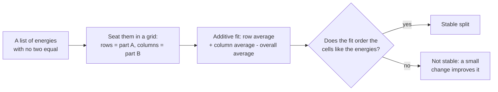

# Splitting a quantum system into parts: an exact test for the stable splits

**A quantum system does not come with built-in parts. If you choose the split whose parts interact least, many
different splits turn out to be "stable". For a simple spectrum (no two energy levels equal) we prove an exact test for
which splits are stable. For two parts the test becomes a puzzle about numbers in a grid, and it explains the counts 1,
5, 14, 42 and 18 that McConnell and Jennings had found by computer without an explanation. Degenerate spectra stay open.**

[](https://doi.org/10.5281/zenodo.23275890)

**Moki & Julio · 2026** · DOI [10.5281/zenodo.23275890](https://doi.org/10.5281/zenodo.23275890) (all
versions; v1.0: 10.5281/zenodo.23275891)

**Read** [PAPER.md](PAPER.md) · **Numbers** [SUPPLEMENT.md](SUPPLEMENT.md) · **New in v1.1** [ADDENDUM-C.md](ADDENDUM-C.md),
[ADDENDUM-D.md](ADDENDUM-D.md)

## The story in a minute

A quantum system is described by its **Hamiltonian**: the list of its energy levels (its **spectrum**) and how they are
arranged. Nothing in that description says "this is part A and that is part B". **Quantum mereology** asks whether the
Hamiltonian alone singles out a split into subsystems. A widely used rule is **minimal interaction**: choose the split
whose parts interact the least.

That rule has many local winners: splits that cannot be improved by any small change. We call them **stable** here; the
paper says "local optima". In symplectic geometry (a branch of geometry whose language the paper uses), the interaction
cost is smallest exactly where a related quantity, the squared size of a "moment map", is largest (both terms are in
"Words you will meet"). So the question becomes: where are the local maxima of that quantity?

A picture that helps (it is only a picture): split a 6-level system into a 2-level part and a 3-level part, and think of a
2 x 3 grid of seats, one row per state of the first part and one column per state of the second. Seat each energy level
in one cell. Where the picture breaks: quantum mechanics allows far more than seatings, because the states of the
system can be mixed together in any (unitary) way, not just reseated. A known result of Biliotti, with a one-line
corollary recorded in the paper, shows that every stable split is a seating of this kind once the states inside each
part are suitably mixed among themselves (a "change of basis" inside each part).

What we found, **for a simple spectrum**: an exact test that says which seatings are stable (Theorems 1 and 2). For two
parts, a test of the same kind classifies the splits that leave the parts least correlated (mutual information).
Combined with the classical result of Jevtic, Jennings and Rudolph that the least-correlated state is always a seating,
it explains the counts 1, 5, 14, 42, 18 for grids 2x2, 2x3, 2x4, 2x5 and 3x3, which McConnell and Jennings had computed
numerically. Degenerate spectra (two or more equal energies) stay open. The proofs are complete and in the paper.

## Climb the ladder

### Step 1 - the idea (for anyone)

For two parts, the test reads like this. Seat the energies in the grid. Now build the "additive fit" of that seating:
for each cell, take its row's average plus its column's average minus the average of everything. The seating is stable
**exactly when the fit puts the cells in the same order as the energies do**.

So the only orders that can ever be stable are orders that some "row number plus column number" can produce. Those
orders have a name, **Klyachko's cubicles** (also called realizable standard Young tableaux), and each one is the winning
pattern for some list of energies. Counting them gives the McConnell-Jennings numbers.



### Step 2 - how it works (for a curious student)

Write the ranks 1 to 9 of the energies (1 = lowest) into a 3 x 3 grid so that every row and every column increases.
There are 42 ways to do that. Which of them can come from "row number + column number"?

**One that can.** The grid 123 / 456 / 789 (rows separated by "/"). Take row numbers x = (0, 3, 6) and column numbers
y = (0, 1, 2). The sums x_a + y_b are 0, 1, 2 / 3, 4, 5 / 6, 7, 8: they rise in exactly the order of the grid.

**One that cannot.** The grid 126 / 347 / 589. Write L(a, b) = x_a + y_b, with rows and columns numbered 0 to 2. Reading
the grid gives three inequalities that would have to hold:

    x0 + y1 < x1 + y0,    x2 + y0 < x0 + y2,    x1 + y2 < x2 + y1.

Add them up. Both sides become x0 + x1 + x2 + y0 + y1 + y2, so the sum says "something < itself", which is impossible. No
choice of numbers works. Such an impossibility proof is called a **Farkas certificate**.

Exactly 6 of the 42 grids fail like this; 36 pass. A grid and its mirror image (swap rows and columns) describe the same
split when both parts have 3 levels, so the 36 pair up into **18** patterns: 18 kinds of seating, each of which is the
best split for some list of energies. That is the McConnell-Jennings count for 3 x 3. It is not the number of stable
splits of one system: a single list of energies has at most 18 stable classes. For 2 x 2 there are 2 grids, one pair,
so the count is **1**. In fact, for 2 x 2 there is exactly one stable split class for every simple spectrum.

### Step 3 - the real thing (for specialists)

Setting: H Hermitian with simple spectrum; K a compact connected subgroup of U(d) acting on the unitary orbit by
conjugation; P the orthogonal projection onto the Hermitian part of Lie(K) plus the scalars; D a point of the orbit.

- **Theorem 1 (any such K, F = ||.||²).** Credited: critical points satisfy [P(D), D] = 0 (Kirwan, Ness); at a local
  maximum the K-orbit is symplectic and the stabilisers agree (Biliotti); recorded here as a one-line corollary, a local
  maximum is fixed by a maximal torus T.
  Proved here: a T-fixed point D is a local maximum **if and only if** P(D) orders the eigenvalues of D strictly as D does
  across distinct T-weight spaces; it is then a strict local maximum modulo an explicit set of critical points; a tie
  across weight spaces is never a local maximum.
- **Theorem 2.** The same test, with P(D) replaced by the gradient of F, for every C² K-invariant F(P(H')) with
  positive-definite second derivative.
- **Theorem 3 (two parties, mutual information).** On the unitary orbit of a full-rank bipartite state with simple
  spectrum, the local minima of mutual information are the classical states whose probabilities are ordered like the
  product of their own marginals: Klyachko's cubicles.
- **Theorem 4 and Corollary 5.** Every cubicle is the unique global-minimiser class on a nonempty open set of spectra,
  for both functionals; with Jevtic-Jennings-Rudolph this identifies the counts 1, 5, 14, 42, 18 with cubicle counts.
  Appendix A gives exact Farkas certificates for the six non-realizable 3x3 tableaux; Appendix B exact integer witnesses.
- **v1.1, Addendum C.** One spectrum cannot make all 3,330 realms of 4x4 stable at once, nor all 516 of five qubits; it
  can at 2x3, 2x4, 2x5, 3x3 and three and four qubits. The 4x4 maximum lies in [1209, 2845]. Every answer has an
  exact integer certificate.
- **v1.1, Addendum D.** Near absolute zero, the least-correlated split of a thermal state is the one that keeps the first
  level exciting both parts as high as possible: the lowest levels fill one row and one column (Theorem D1,
  Corollary D2, for spectra off finitely many hyperplanes).

Credited results and locators: Section 3 of [PAPER.md](PAPER.md). Line-by-line comparison with Georgoulas-Robbin-Salamon's
Hessian lemma: Section 8.

## Use it as a tool

Questions this lets you answer:

- Which orders of a grid can ever be a stable split, and which are ruled out (with a proof you can check)?
- Can one list of energies make every realm of a given shape stable at once?
- How many least-correlated classes does a grid shape have?

**Re-run the core checks** (Python 3.11 with NumPy, SciPy and networkx; `mi_census.py` also imports torch, CPU is
enough). Run from `probe/`:

```
git clone https://github.com/Hashirama1337s/moment-map-local-maxima
cd moment-map-local-maxima/probe
python ../theory/check_d5.py        # exact check of every Addendum C proof object, pure Python, seconds
python ../theory/farkas3x3.py       # Appendix A certificates and Appendix B witnesses, seconds
python ../theory/mi_census.py       # McConnell-Jennings counts, about half a minute
```

`check_d5.py` ends with `ALL CHECKS PASS`, `farkas3x3.py` with `ALL EXACT CHECKS PASS`, and `mi_census.py` prints the
class counts:

```
2x2 {'classes': 1, 'nonrealizable_argmins': 0, 'spectra': 20000, 'realizable_classes': 1, 'SYT': 2}
2x3 {'classes': 5, 'nonrealizable_argmins': 0, 'spectra': 20000, 'realizable_classes': 5, 'SYT': 5}
2x4 {'classes': 14, 'nonrealizable_argmins': 0, 'spectra': 20000, 'realizable_classes': 14, 'SYT': 14}
2x5 {'classes': 42, 'nonrealizable_argmins': 0, 'spectra': 20000, 'realizable_classes': 42, 'SYT': 42}
3x3 {'classes': 18, 'nonrealizable_argmins': 0, 'spectra': 20000, 'realizable_classes': 18, 'SYT': 42}
```

The census is numerical (20,000 random spectra per shape) and is not used in any proof. Every other command, with its
expected output, is in the Reproduce table of the original README below.

**Reuse: test your own grid.** Save this as `probe/mygrid.py` and run `python mygrid.py` from `probe/`. Grids are written
with ranks 0 to 8 (0 = lowest energy); the two below are the examples of Step 2.

```python
import sys, numpy as np
sys.path.insert(0, '../theory')
import farkas3x3 as F

good = np.array([[0, 1, 2], [3, 4, 5], [6, 7, 8]])   # tableau 123/456/789, written with ranks 0..8
bad  = np.array([[0, 1, 5], [2, 3, 6], [4, 7, 8]])   # tableau 126/347/589
print(F.find_witness(good))            # row numbers x and column numbers y whose sums x_a + y_b rise in this order
print(F.find_witness(bad))             # None: no such numbers exist
print(F.find_pair_certificate(bad))    # three inequalities that add up to "something < itself"
```

It prints `([0, 3, 6], [0, 1, 2])`, then `None`, then the three inequalities of Step 2 as cell pairs:
`[((0, 1), (1, 0), 1), ((2, 0), (0, 2), 1), ((1, 2), (2, 1), 1)]`. `find_witness` takes any m x n grid and verifies its
answer in exact integer arithmetic before returning it; `find_pair_certificate` searches certificates of up to four
inequalities.

## What we did not show

- **Degenerate spectra.** The proofs use distinct energies; nothing is claimed when two or more are equal.
- The cubicle counts bound the number of stable classes at a *single* spectrum only from above (3330 at 4x4, 124,187 for
  six qubits). Addendum C shows the bound is not attained at 4x4, 2x6, 2x8, 3x4 or five qubits; the exact 4x4 maximum is
  only bracketed, in [1209, 2845].
- General Hamiltonian K-manifolds are not treated.
- The equivalence of this landscape with the sorted-eigenvalue landscape minimised by released code is an observation,
  not a theorem.
- Addendum D: a finer leading-order tie-break formula (Conjecture D3) is tested, not proved.
- Numerics (Hessian cross-checks, censuses, timings, branch-and-bound, greedy ratios) are not used in any proof.
- The paper was read adversarially by independent reviewers before release; this is not journal peer review.

## Words you will meet

- **Hamiltonian** - the description of a quantum system's energy; its eigenvalues are the energy levels.
- **Spectrum; simple spectrum** - the list of energy levels; "simple" means no two are equal ("degenerate" if some are).
- **Split (tensor-product structure)** - a way of viewing one system as two or more parts.
- **Minimal interaction** - the rule "choose the split whose parts interact least".
- **Stable split (local optimum, realm)** - a split that no small change improves.
- **Symplectic geometry** - a branch of geometry; the paper states the problem in its language.
- **Moment map** - a tool from symplectic geometry; here, the projection P onto what the parts can do on their own.
- **Unitary change; change of basis** - the ways quantum states may be mixed with each other; inside one part, a
  relabelling and mixing of that part's own states.
- **Mutual information** - how much knowing one part tells you about the other.
- **Additive fit** - row average plus column average minus overall average.
- **Cubicle (realizable standard Young tableau)** - a grid order that some "row number + column number" produces.
- **Farkas certificate** - inequalities that add up to an impossibility, proving that no numbers fit.

---

## For specialists: the original README

# Local maxima of the moment-map norm on a unitary orbit: a root-block sign test, mutual information, and Klyachko's cubicles

[](https://doi.org/10.5281/zenodo.23275890)

**Moki & Julio · 2026** · DOI [10.5281/zenodo.23275890](https://doi.org/10.5281/zenodo.23275890) (all versions; v1.0: 10.5281/zenodo.23275891) · paper: [PAPER.md](PAPER.md) · numerical ledger: [SUPPLEMENT.md](SUPPLEMENT.md) · version 1.1 addenda: [ADDENDUM-C.md](ADDENDUM-C.md), [ADDENDUM-D.md](ADDENDUM-D.md)

## In plain words

A quantum system's description does not come with a built-in division into parts. Quantum mereology (paper references
[CS, CPR, St, SFD]) asks whether a Hamiltonian alone singles out a split of Hilbert space into subsystems. A widely used criterion is minimal interaction [LS, Zanardi,
Cao]: choose the split whose parts interact the least. In the language of symplectic geometry, that cost is minimised
exactly where the squared norm of a moment map is maximised, and the question becomes: where are the local maxima of that
function on a unitary orbit?

For a simple spectrum, the paper proves which torus-fixed splits are local optima: a torus-fixed point is a local maximum
if and only if its projection orders the eigenvalues strictly as the point itself does, across distinct weight spaces. For
two parties it also proves which classes are the global minimisers, both for minimal interaction and for mutual
information, and identifies a set of class counts that McConnell and Jennings had computed numerically without an
explanation. Degenerate spectra stay open. Everything needed to check the proofs and re-run the numbers is here.

**New in version 1.1.** Two addenda.
- [Addendum C](ADDENDUM-C.md) answers a question the paper left open. Can one list of energies make every possible split
  stable at once? No for a 16-level system split 4 x 4 (3,330 possible splits) and for five qubits (516). Yes for the small
  cases, up to 2 x 5, 3 x 3 and four qubits. Each answer is a proof that can be checked with whole numbers alone. At 4 x 4 the
  true maximum lies between 1,209 and 2,845, and two specific splits can never be stable together.
- [Addendum D](ADDENDUM-D.md) proves which split of a thermal state is least correlated near absolute zero. It is the split
  that pushes the first level exciting both parts as high as possible: the lowest levels fill one row and one column.

## What the paper proves

Setting: H Hermitian with simple spectrum; K a compact connected subgroup of U(d) acting on the unitary orbit by
conjugation; P the orthogonal projection onto the Hermitian part of Lie(K) plus the scalars; D a point of the orbit.

- **Theorem 1 (any such K, F = ||.||^2).** Credited: critical points satisfy [P(D), D] = 0 (Kirwan, Ness); at a local
  maximum the K-orbit is symplectic and the stabiliser of the point equals the stabiliser of its moment-map image
  (Biliotti). Recorded here as a one-line corollary: a local maximum is fixed by a maximal torus T. Proved here: a T-fixed
  point D is a local maximum **if and only if** P(D) orders the eigenvalues of D strictly as D does across distinct
  T-weight spaces; it is then a strict local maximum modulo an explicit set of critical points (the K-orbit of D when the
  weights are multiplicity-free); a tie across weight spaces is never a local maximum.
- **Theorem 2 (any such K, general F).** The same test, with P(D) replaced by the gradient of F, holds for every C^2
  K-invariant functional F(P(H')) with positive-definite second derivative.
- **Theorem 3 (two parties, mutual information).** On the unitary orbit of a full-rank bipartite state with simple
  spectrum, the local minima of mutual information are the classical states whose probabilities are ordered like the
  product of their own marginals. Those orders are Klyachko's cubicles (realizable standard Young tableaux).
- **Theorem 4 (two parties, attainment).** Every cubicle is the unique global-minimiser class on a nonempty open set of
  spectra, for both functionals.
- **Corollary 5.** Combined with the classical global minimum of mutual information (Jevtic, Jennings, Rudolph), Theorem 4
  identifies the class counts 1, 5, 14, 42, 18 (shapes 2x2, 2x3, 2x4, 2x5, 3x3), which McConnell and Jennings had computed
  numerically and left unexplained, with cubicle counts. Appendix A gives exact Farkas certificates for the six
  non-realizable 3x3 tableaux; Appendix B lists exact integer witnesses for the 36 realizable 3x3 tableaux and for all 2xn
  tableaux, n = 2..5.

Limits, stated in the paper (Section 9): the spectrum must be simple; the cubicle counts bound the number of local minima
at a *single* spectrum only from above (3330 at 4x4, 124,187 for six qubits). Addendum C (v1.1) shows that the bound is not
attained at 4x4, 2x6, 2x8, 3x4 or five qubits; it brackets the 4x4 maximum in [1209, 2845]. General Hamiltonian
K-manifolds are not treated.

## What is in the repository

| Path | Contents |
|---|---|
| [PAPER.md](PAPER.md) | The theorem paper: definitions, credited known results (Section 3), Theorems 1-4 with complete proofs, corollaries, a line-by-line comparison with Georgoulas-Robbin-Salamon's Hessian lemma (Section 8), scope and open problems (Section 9), Appendices A-B. |
| [SUPPLEMENT.md](SUPPLEMENT.md) | The numerical ledger: exact combinatorics, attainment numerics, Hessian cross-checks, exact algorithms, censuses, the greedy-versus-exact comparison, material cut from the main text, and the recorded failures and corrections (S8). None of it is used in a proof. |
| `theory/` | Software: tableau enumeration and Hessian classification (`t1.py`), realizable-tableau counts (`realizable.py`), exact qubit split by parametric perfect matching (`qubit_exact.py`), exact grid branch-and-bound (`bb.py`), coherent-order enumeration for qubits (`door4*.py`), mutual-information census (`mi_census.py`), Farkas certificates and witnesses (`farkas3x3.py`), censuses (`census.py`, `maxmin.py`, `witness.py`, `torus.py`), greedy peeling (`door3.py`). |
| `theory/general/` | Checks of the general-K statements (`gen_core.py`, `run_case.py`, `mi.py`, `attain.py`) and their results. |
| `theory/proof/` | The degenerate-local-part search (`core.py`, `core_k.py`, `search.py`) and its results. |
| `theory/results/` | Every result file the supplement cites. The n = 6 coherent-order enumeration is shipped compressed as `coherent_n6.npz` (key `ranks`). |
| `probe/` | Implementation A (`impl_a.py`, GPU-capable) and implementation B (`impl_b*.py`), written separately from a shared specification, with their evaluation scripts. |
| `probe/independent_b2/` | Implementation B2: an independent exact qubit-split and coherent-order enumeration (integer double description with a completeness certificate), with its logs. |
| [ENV.txt](ENV.txt) | The software versions used. |
| [ADDENDUM-C.md](ADDENDUM-C.md) | v1.1: simultaneous realms (the single-spectrum bound), exact LP with integer certificates. |
| [ADDENDUM-D.md](ADDENDUM-D.md) | v1.1: the cold limit of the least-correlated split of a thermal state; theorem, proof and exact test. |
| `theory/d5lp*.py`, `theory/check_d5.py` | v1.1: LP builder and searches, certificate export, and a stand-alone pure-Python exact checker. |
| `theory/results/d5lp/certificates/` | v1.1: every proof object of Addendum C (rational spectra, integer certificates with realizability witnesses, 485 cores), with SHA256SUMS. |
| `theory/d13_cold*.py`, `theory/d13_cancellation_demo.py`, `theory/results/d13/` | v1.1: exact multi-precision cold-limit test of Addendum D, its verdict script, the double-precision cancellation example, and the stored inputs. |
| `prereg/` | v1.1: the predictions and pass/fail bars of both addenda as written before the runs, with their SHA-256 hashes. |

## Reproduce

Python 3.11 with NumPy, SciPy and networkx; `torch` with CUDA only for `impl_a.py`, `t1.py T12` and `bb.py` (CPU fallback
works, slower). Run the `../theory` commands from `probe/`; `regions.py` runs from `probe/independent_b2/`. The commands
are written with `python`; the supplement's ledger records the same invocations with the Windows launcher `py`. The
"expected" column is program output as recorded in the supplement. The class-count and single-spectrum figures in the
paper's abstract and Section 9 are 1, 5, 14, 42, 18, 3330, 124,187 and 1114; Appendix A states six non-realizable 3x3
tableaux and Appendix B states 36 realizable 3x3 witnesses.

| Result | Command | Output | Expected |
|---|---|---|---|
| Hessian formula vs autograd (cross-check of the block formula; SUPPLEMENT S3) | `python ../theory/t1.py T12 4 5 5` | `theory/results/T12_n4.json` | relative difference < 1e-8 |
| Local minimum <=> order test, d = 16, 1000 checks (SUPPLEMENT S3) | `python ../theory/t1.py T3 5 100` | `T3.json` | 1000/1000 |
| Realizable tableau counts (OEIS A211400; SUPPLEMENT S1) | `python ../theory/realizable.py` | `realizable.json` | 36 / 295 / 6660 |
| Mutual-information census (Corollary 5; SUPPLEMENT S1) | `python ../theory/mi_census.py` | `mi_census.json` | 1 / 5 / 14 / 42 / 18 |
| Farkas certificates and witnesses (Appendices A-B) | `python ../theory/farkas3x3.py` | `farkas3x3.json` | all exact checks pass |
| Attainment numerics (illustration of Theorem 4; SUPPLEMENT S2) | `python ../theory/general/attain.py tableaux 2 5`; `python ../theory/general/attain.py radius 3 3 7` | `theory/general/results/attain_syt_2x5.json`, `attain_3x3_7.json` | see SUPPLEMENT S2 |
| Exact qubit split = enumeration (SUPPLEMENT S4) | `python ../theory/qubit_exact.py E1a` | `E1a.json` | max difference <= 1e-12 |
| Exact grid branch-and-bound = enumeration (SUPPLEMENT S4) | `python ../theory/bb.py E2a` | `E2a.json` | EXACT |
| Coherent Boolean term orders (OEIS A009997; SUPPLEMENT S5) | `python ../theory/door4.py ENUM n` (n = 3..6) | `coherent_n*.npy` | 2 / 14 / 516 / 124,187 |
| Independent enumeration with completeness certificate (SUPPLEMENT S4) | `python regions.py 6` (from `probe/independent_b2/`) | `regions_n6.log` | 124,187 regions, 0 missing |
| Single-spectrum census (SUPPLEMENT S5) | `python ../theory/census.py 100` | `census.json` | table in SUPPLEMENT S5 |
| All realms at once, controls and table (Addendum C) | `python ../theory/d5lp.py CONTROLS`; `python ../theory/d5lp.py JOINT` | `theory/results/d5lp/controls.json`, `joint.json` | table of Proposition C1 |
| Exact check of every Addendum C proof object (no LP) | `python ../theory/check_d5.py` | printed | ALL CHECKS PASS |
| Bracket searches (Addendum C, about 15 min each; MILP 3 min) | `python ../theory/d5lp.py GREEDY`; `python ../theory/d5lp.py UPPER`; `python ../theory/d5lp_milp_probe.py` | `greedy.json`, `upper.json`, `milp_probe.json` | 1164; 485 cores; see Addendum C |
| Cold-limit exact test (Addendum D, about 5 min) | `python ../theory/d13_cold.py`; `python ../theory/d13_cold_verdict.py` | `theory/results/d13/cold.json` | table of Addendum D |

## What is new and what is credited

Credited in Section 3 of the paper, each with a locator, and not claimed here: the critical-point condition (Kirwan-Ness;
matrix form Chu-Driessel Lemma 3.1 and Woodward Lemma 7.1.1; gradient form Georgoulas-Robbin-Salamon Lemma 3.1), the
symplectic-orbit and stabiliser results at a local maximum (Biliotti), the global minimum at product-diagonal states
(Tegmark, with the Soulas critique and a convexity proof; Jevtic-Jennings-Rudolph for mutual information), the one-factor
case (Brockett, via Helmke-Moore), cubicles and sweep polytopes (Klyachko;
Castillo-Labbe), realizable tableaux (Mallows-Vanderbei; OEIS A211400), coherent Boolean term orders (Maclagan; Fine-Gill;
OEIS A009997), and the McConnell-Jennings counts themselves. Section 8 compares the Hessian used here, line by line, with
Georgoulas-Robbin-Salamon's Lemma 3.5.

New in the paper: Theorems 1-2 (b)-(d) (the root-block sign test, the variance identity, the exact tie formula and the
slice argument), Lemma 5.1 (the second-order torus statement with an explicit ascent direction), Theorems 3 and 4, and
the Farkas certificates of Appendix A. New in v1.1: Propositions C1-C3 (Addendum C) and Theorem D1 / Corollary D2
(Addendum D); Conjecture D3 is tested, not proved.

Software in this repository, not part of the mathematical claims: the exact algorithms (parametric perfect matching for
qubit splits, branch-and-bound over partial tableaux, LP-pruned coherent-order enumeration) and the three implementations.

## Honesty record

The supplement keeps the failures and corrections made during this work (S8), the cross-check tolerances actually
observed (S3-S4), and the material cut from the main text with the reason (S7). The paper was read adversarially by
independent reviewers before release; this is not journal peer review.

This work was done with AI assistance. Nothing in it should be relied on without reading the proofs; they are complete and
in the paper.

## Cite

```
Moki & Julio (2026). Local maxima of the moment-map norm on a unitary orbit: a root-block sign test, mutual
information, and Klyachko's cubicles. Version 1.1. DOI 10.5281/zenodo.23275890.
```

See [CITATION.cff](CITATION.cff). Text and figures: CC BY 4.0 ([LICENSE](LICENSE)); code: MIT ([LICENSE-CODE](LICENSE-CODE)).

*Prepared with AI assistance; all results are machine-checked.*
